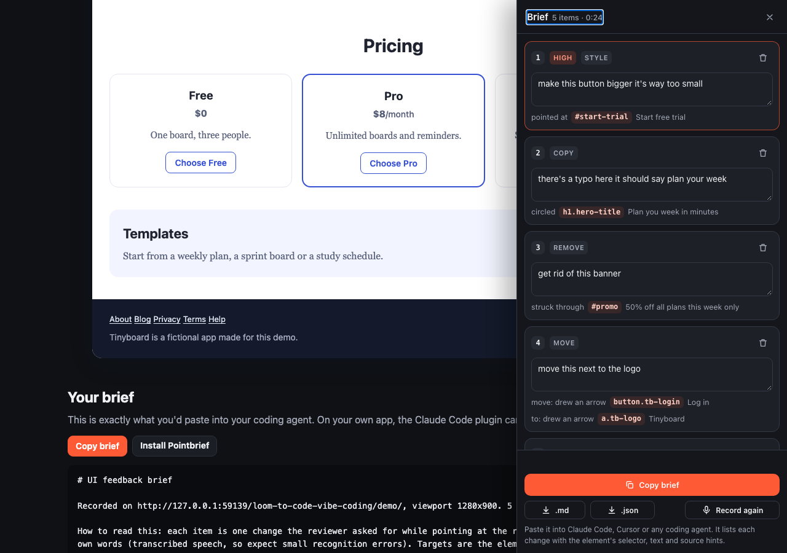

# Pointbrief

**Point at your running app, say what to change, and draw on it. Your coding agent gets a brief it can apply.**

Pointbrief is a free, open-source dev toolbar and Claude Code plugin. You record over your local app the
way you'd record a Loom for a developer: talk, hover and click, circle things, cross them out, draw arrows.
Pointbrief records *events*, not video, so every sentence is tied to the exact element you were pointing
at: its selector, text, current styles, and in React, Vue and Svelte dev builds, the component and source
file. Press **Done** and you get a numbered change list that Claude Code, Cursor or any agent can apply.

**Try it:** https://code.screenrecordit.com/demo/ (runs in your browser, nothing uploaded)



## Install

### Claude Code plugin

```
/plugin marketplace add theguysaccount/loom-to-code-vibe-coding
/plugin install pointbrief@pointbrief
```

Then `/pointbrief:setup` adds the toolbar to your app (in development only), and after you press
**Send to agent** on the toolbar, `/pointbrief:apply` makes the changes and shows you the diff before
anything is committed. Needs Node.js 18+. From a terminal: `claude plugin install pointbrief --marketplace theguysaccount/loom-to-code-vibe-coding`.

### Any web app (script tag)

Add one line to your app's HTML in development:

```html
<script src="https://cdn.jsdelivr.net/gh/theguysaccount/loom-to-code-vibe-coding@v0.1.0/plugin/toolbar/pointbrief.js" defer></script>
```

Then **Copy brief** and paste it into any agent. There's also a bookmarklet on the
[home page](https://theguysaccount.github.io/loom-to-code-vibe-coding/#install), and setups for Vite,
Next.js, Nuxt and SvelteKit in the [docs](https://theguysaccount.github.io/loom-to-code-vibe-coding/docs/).

### Cursor

Import this repository as a plugin (it has a `.cursor-plugin/marketplace.json`), or add the MCP server to
`~/.cursor/mcp.json`: see [Cursor setup](https://theguysaccount.github.io/loom-to-code-vibe-coding/docs/cursor/).

## What a brief looks like

```markdown
## 1. [HIGH] "make this button bigger it's way too small"
- Priority: high (said "way too")
- Likely kind of change: style
- Target, pointed at: `button#start-trial` "Start free trial" (button)
  - selector: `#start-trial`
  - component: `Hero` in `src/components/Hero.tsx:18` (inside App > Landing)
  - now: font-size 12px · color rgb(124, 134, 173) · padding 6px 10px
```

Full example: [Markdown](https://theguysaccount.github.io/loom-to-code-vibe-coding/example-brief.md) ·
[JSON](https://theguysaccount.github.io/loom-to-code-vibe-coding/example-brief.json) ·
[format](https://theguysaccount.github.io/loom-to-code-vibe-coding/docs/brief-format/) ·
[JSON Schema](https://theguysaccount.github.io/loom-to-code-vibe-coding/brief.schema.json)

## Privacy

No screen video, no screenshots, no account, no server. Form values and anything in
`data-pointbrief-private` are never read. Voice is transcribed by your browser (on the device when it
can); the toolbar says which before you start, and you can type instead. The brief leaves the page only
when you copy it, download it, or send it to the plugin on `127.0.0.1`, which accepts only local pages.
Details: [privacy](https://theguysaccount.github.io/loom-to-code-vibe-coding/docs/privacy/).

## Repository layout

| Path | What |
|---|---|
| `src/` | The toolbar: capture (`pointer.js`, `draw.js`, `speech.js`), stroke recognition (`shapes.js`), element description (`elements.js`), the brief (`brief.js`), UI (`toolbar.js`) |
| `plugin/` | The Claude Code / Cursor plugin: MCP server and bridge (`server/server.mjs`), skills, the built toolbar (`toolbar/pointbrief.js`) |
| `site/` | The website: templates, docs in Markdown, demo app, self-test pages |
| `scripts/` | Build (`build.mjs`, a small bundler, Markdown renderer), plugin checks, live checks, IndexNow, keep-alive |
| `tests/` | Unit tests (`node --test`) and browser tests over the Chrome DevTools protocol |

## Develop

No dependencies to install: Node.js 18+ and Google Chrome are enough.

```bash
node --test tests/unit/*.test.mjs     # unit tests
node scripts/build.mjs                # bundle the toolbar into plugin/toolbar/ and build the site into dist/
node scripts/check-plugin.mjs         # manifests, skills, versions, MCP server smoke test
node tests/e2e/run.mjs                # headless Chrome: capture, element mapping, bridge, every page
node tests/e2e/run.mjs --screens      # the same, saving screenshots to docs/screens/
python3 -m http.server -d dist 8000   # browse dist/ (paths assume /loom-to-code-vibe-coding/)
```

Commit `plugin/toolbar/pointbrief.js` with any change to `src/`: CI fails if it doesn't match the source.

## Deploy

Pushing to `main` runs `.github/workflows/pages.yml`: tests, build, deploy to GitHub Pages, the browser
tests again on the live site, then IndexNow. A failing test stops before the deploy. The weekly
self-test, keep-alive and keys are in [OPERATIONS.md](OPERATIONS.md).

## License

MIT. Contributions welcome: open an issue first for anything large.
